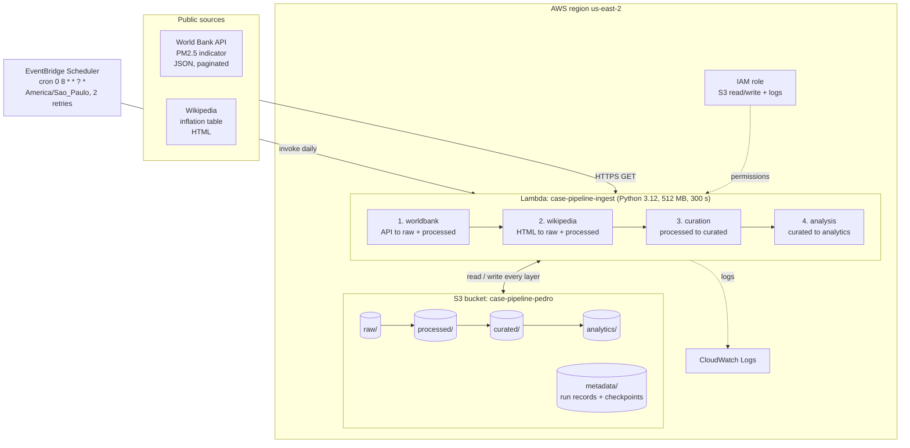
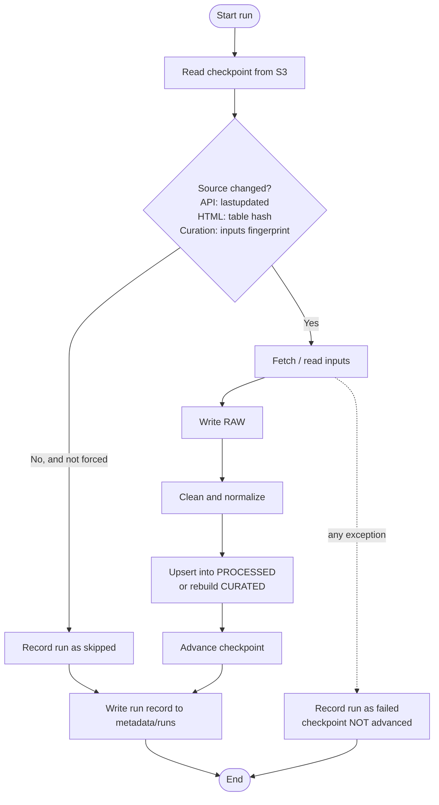
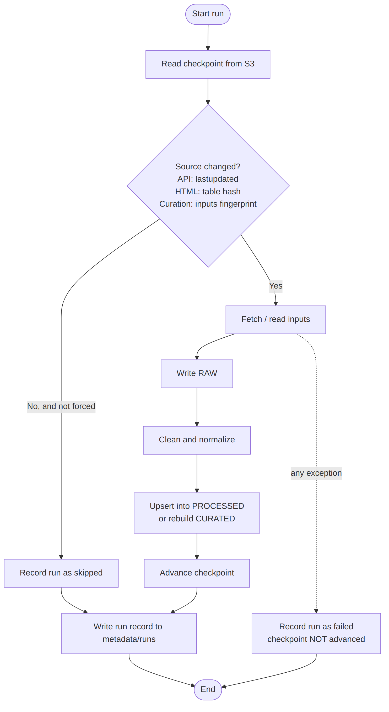

# Technical Documentation

Cloud-native incremental pipeline: World Bank API + Wikipedia crawler -> curated dataset -> analytical report.

**Contents:** [1. Architecture](#1-architecture-diagram) | [2. Pipeline in detail](#2-detailed-pipeline-explanation) | [3. Cloud components](#3-cloud-components-and-responsibilities) | [4. Data models](#4-data-models) | [5. Operational considerations](#5-operational-considerations) | [6. Reference run](#6-reference-run)

---

## 1. Architecture Diagram

*Static copy of the diagram (for viewers without Mermaid support):* 

Incremental decision flow (same pattern in every stage):

*Static copy:* 

---

## 2. Detailed Pipeline Explanation

### 2.1 Orchestration and scheduling

- `EventBridge Scheduler` invokes the Lambda once a day (`0 8 * * ? *`, time zone `America/Sao_Paulo`) with the payload `{}`. Retries are limited to 2.
- `pipeline.orchestrator.lambda_handler` calls `run_all()`, which executes the stages **in order**: `worldbank` -> `wikipedia` -> `curation` -> `analysis`.
- If a stage raises, the exception propagates: later stages do not run, the Lambda invocation is marked as failed, and the failing stage has already written a `failed` run record. The next scheduled run starts from the last good checkpoints.
- The event `{"force": true}` makes every stage ignore its checkpoint (`--force` locally).

### 2.2 Ingestion flow: API (World Bank)

1. Read `metadata/checkpoints/worldbank_api_<indicator>.json` (`source_lastupdated`, `max_year_loaded`).
2. Compute the year window: `start = max(WB_START_YEAR, max_year_loaded - 1)` (2-year refresh window to capture upstream revisions), `end = current year`.
3. Request page 1 of `/country/all/indicator/<indicator>?date=start:end&per_page=1000`. The response metadata gives `pages` and `lastupdated`.
4. If `lastupdated` equals the checkpoint, **skip** (record the run and stop).
5. Otherwise paginate through the remaining pages; every page is saved untouched to `raw/` (`{"meta": ..., "data": [...]}`).
6. Fetch the country dimension (`/country`), save it to `raw/`, and keep only real countries (the API mixes in aggregates such as "World" or "Euro area", identified by region `Aggregates`).
7. Normalize observations (see 2.4) and **upsert** into `processed/worldbank/<indicator>.csv` by `(country_iso3, year)`.
8. Advance the checkpoint, write the run record.

### 2.3 Ingestion flow: crawler (Wikipedia)

1. Download the page HTML (descriptive User-Agent, retries).
2. Locate the table by its **header** (first column "Country" plus at least three year columns), not by position; if not found, raise an error ("layout may have changed").
3. Hash the raw text of all table cells (SHA-256). If equal to the checkpoint, **skip**.
4. Otherwise store the original HTML in `raw/` and parse the table.
5. Clean each cell (see 2.4), convert the wide table (country x years) into long format, and **upsert** into `processed/wikipedia/inflation_by_country_year.csv` by `(country_name, year)`.
6. Advance the checkpoint (hash, page revision id), write the run record.

### 2.4 Transformation steps

**World Bank**
- Drop aggregate regions (784 rows in the reference run) and null observations (672 rows).
- Cast `year` to integer and `value` to float; trim names; keep `unit` and `obs_status`.
- Add lineage columns `source_lastupdated` and `ingested_at`.

**Wikipedia** (HTML inconsistencies handled; counters are reported in the run metrics)

| Inconsistency | Handling | Metric |
|---|---|---|
| Empty cells / `n/a` / dashes (104 in the reference run) | Treated as missing, row not emitted | `empty_cells_dropped` |
| Footnote markers `[a]`, `` | Removed before reading text | `footnotes_removed` |
| Hidden text (`display:none`) | Removed | `hidden_text_removed` |
| Duplicated names ("X X") | Collapsed to "X" | `duplicated_names_fixed` |
| Unicode minus (U+2212) and `-0.0` | Normalized to `-` and `0.0` | `unparseable_values` for what cannot be parsed |
| Rows with a different number of cells than the header | Skipped and counted | `malformed_rows_skipped` |

In the reference run only empty cells occurred on the live page; the other handlers are covered by unit tests with a synthetic HTML fixture.

**Curation**
- Match each Wikipedia country name to an ISO3 code: first an **alias dictionary** (e.g. "Russia" -> `RUS`, "Turkey" -> `TUR`), then **normalized-name** equality (lowercase, accents and punctuation removed).
- Inner join PM2.5 and inflation on `(country_iso3, year)`; attach `region` and `income_level` from the World Bank country dimension.
- Names with no match are written to `curated/unmatched_countries.csv` and listed in the run metrics.

**Analysis**
- Per country (minimum 3 overlapping years): mean PM2.5 and **median** inflation (median resists outliers).
- Spearman correlation (rank-based, ties averaged) as the primary metric, Pearson as secondary.
- Yearly trend and summaries by income group and region.
- Outputs: `report.html`, `summary.json`, three SVG charts, all generated in pure Python.

### 2.5 Storage layers

| Layer | Prefix | Content | Written by |
|---|---|---|---|
| Raw | `raw/` | Untouched API pages and HTML, partitioned by `ingest_date` and `run` | Stages 1-2 |
| Processed | `processed/` | Cleaned, typed, deduplicated CSV per source | Stages 1-2 |
| Curated | `curated/` | Joined analytical dataset + unmatched report | Stage 3 |
| Analytics | `analytics/` | Report, charts, summary | Stage 4 |
| Metadata | `metadata/` | Run records and checkpoints | All stages |

Raw is append-only (new run folder each time), so any processed or curated table can be rebuilt from it.

### 2.6 Metadata tracking implementation

`track_run()` in `metadata.py` is a context manager wrapped around every stage. Whatever happens, a JSON record is written in its `finally` block to `metadata/runs/source=<source>/<UTC timestamp>_<run id>.json` with:

| Field | Meaning |
|---|---|
| `run_id` | UUID of the run |
| `source` | `worldbank_api`, `wikipedia_crawler`, `curation`, `analysis` |
| `ingestion_timestamp` / `finished_at` | UTC start and end |
| `duration_seconds` | Execution metric |
| `status` | `success` or `failed` (+ `error` text) |
| `metrics` | Row counts (`rows_fetched`, `rows_inserted`, `rows_updated`, `rows_unchanged`, `rows_total_processed`), pages fetched, cleaning counters, year range, `skipped` + `reason` |

Checkpoints (`metadata/checkpoints/`) are separate small files holding the "last successful state" of each stage.

---

## 3. Cloud Components and Responsibilities

| Component | Responsibility |
|---|---|
| **S3** `case-pipeline-pedro` | Single source of truth: all layers, run records, checkpoints. Block Public Access on; versioning recommended for resilience |
| **Lambda** `case-pipeline-ingest` | Executes all four stages. Handler `pipeline.orchestrator.lambda_handler`; Python 3.12, 512 MB, 300 s timeout (reference run used ~116 MB, ~3 s when everything is skipped) |
| **EventBridge Scheduler** `case-pipeline-daily` | Daily trigger with up to 2 retries |
| **IAM role** `case-pipeline-lambda-role` | `AWSLambdaBasicExecutionRole` (logs) + inline policy allowing `s3:GetObject`, `s3:PutObject` on the bucket objects and `s3:ListBucket` on the bucket (file `infra/lambda-s3-policy.json`). `ListBucket` also makes a missing key return `NoSuchKey` instead of `AccessDenied`, which the code relies on to detect "no checkpoint yet" |
| **CloudWatch Logs** | Per-invocation logs (stage start/end, metrics) |

Deployment steps and configuration are in [`CLOUD_EXECUTION.md`](CLOUD_EXECUTION.md).

---

## 4. Data Models

### 4.1 Raw

| Path | Content |
|---|---|
| `raw/worldbank/indicator=<id>/ingest_date=YYYY-MM-DD/run=<8 chars>/page_NNN.json` | `{"meta": {page, pages, per_page, total, sourceid, lastupdated}, "data": [ {indicator, country, countryiso3code, date, value, unit, obs_status, decimal}, ... ]}` exactly as returned |
| `raw/worldbank/countries/ingest_date=.../run=.../page_NNN.json` | Country dimension pages, same wrapper |
| `raw/wikipedia/inflation/ingest_date=.../run=.../page.html` | Full page HTML as downloaded |

### 4.2 Processed

**`processed/worldbank/EN.ATM.PM25.MC.M3.csv`**: key `(country_iso3, year)`

| Column | Type | Notes |
|---|---|---|
| `country_iso3` | string | ISO3 code (join key) |
| `country_name` | string | Name as given by the API |
| `indicator_id` | string | `EN.ATM.PM25.MC.M3` |
| `year` | int | |
| `value` | float | Mean annual PM2.5 exposure, ug/m3 |
| `unit`, `obs_status` | string | Passed through (may be empty) |
| `source_lastupdated` | string | API `lastupdated` when loaded |
| `ingested_at` | timestamp (UTC, ISO 8601) | Lineage |

**`processed/worldbank/countries.csv`**: key `country_iso3`: `country_iso3`, `country_iso2`, `country_name`, `region`, `income_level` (aggregates excluded; 217 countries).

**`processed/wikipedia/inflation_by_country_year.csv`**: key `(country_name, year)`

| Column | Type | Notes |
|---|---|---|
| `country_name` | string | Cleaned name from the table |
| `year` | int | 2015-2024 |
| `inflation_pct` | float | Annual inflation in percent |
| `wiki_revision_id` | string | Page revision when loaded (best effort) |
| `ingested_at` | timestamp (UTC) | Lineage |

### 4.3 Curated

**`curated/country_year_pm25_inflation.csv`**: key `(country_iso3, year)`

| Column | Type | Notes |
|---|---|---|
| `country_iso3` | string | |
| `country_name` | string | World Bank name (authoritative) |
| `region`, `income_level` | string | World Bank classification |
| `year` | int | 2015-2023 (overlap of both sources) |
| `pm25_ugm3` | float | From the API |
| `inflation_pct` | float | From the crawler |
| `curated_at` | timestamp (UTC) | |

**`curated/unmatched_countries.csv`**: `country_name`, `year_rows` (empty in the reference run).

### 4.4 Analytics

`analytics/report.html`, `analytics/summary.json` (correlations, yearly trend, group summaries), `analytics/scatter_pm25_vs_inflation.svg`, `analytics/trend_pm25.svg`, `analytics/trend_inflation.svg`.

### 4.5 Naming conventions and normalization decisions

- Columns and paths in `snake_case`; Hive-style partitions (`key=value`) in raw and metadata paths so query engines (e.g. Athena) could be added later.
- ISO3 is the canonical country key; names are only used to *reach* ISO3 and are kept for readability.
- Units are part of the column name (`pm25_ugm3`, `inflation_pct`).
- UTC ISO 8601 timestamps everywhere.
- Wikipedia's wide table is reshaped to long format so both sources share the grain *country x year*.
- Inflation is summarised by median and PM2.5 by mean at country level, because inflation has extreme outliers.
- CSV over Parquet: keeps the deployment package to a few MB and avoids a pandas/pyarrow layer; types are re-applied when reading.

---

## 5. Operational Considerations

### 5.1 Error handling
- Every stage runs inside `track_run()`: on any exception a record with `status = failed` and the error text is written, then the exception propagates.
- The orchestrator stops at the first failure; the checkpoint of the failed stage is **not** advanced, so the next run retries the same work.
- The World Bank API reports some errors with HTTP 200 and a `message` field; this is detected and raised as an error.
- A missing or reshaped Wikipedia table raises a clear error instead of producing empty data.
- Missing inputs for curation/analysis raise `FileNotFoundError` with a hint about the order of execution.

### 5.2 Pagination
The API is read with `per_page=1000` and `page=N` until `page >= pages` (5 pages in the reference run, 4,256 rows). Pages are fetched lazily; the first page is used to decide whether anything changed before the rest is downloaded.

### 5.3 Retry logic
- HTTP level: `requests` session with urllib3 `Retry` (5 attempts, exponential backoff with factor 1 s, on 429/500/502/503/504, GET only, honours `Retry-After`) and a 30 s timeout.
- Schedule level: EventBridge Scheduler retries a failed invocation up to 2 times.

### 5.4 Incremental ingestion approach
See section 2.2 / 2.3 and the decision-flow diagram: source change detection (API `lastupdated`, table hash, inputs fingerprint) + year window with refresh + upsert + checkpoint advanced only on success. Ingestion timestamps are stored on every row (`ingested_at`) and in every run record.

### 5.5 Idempotency
- Upserts are keyed by business keys, so re-processing the same data yields the same table: `inserted = 0`, `updated = 0`, `unchanged = N`.
- Processed and curated files are fully rewritten from the merged result, never appended.
- Raw writes go to a new run-specific folder (no overwrite, no collision).
- The checkpoint is written last, after all data writes succeeded; a crash in the middle just causes a repeat of the same work.
- Curation and analysis overwrite their outputs deterministically.
- Covered by unit tests: skip when unchanged, update on revision without duplicates, insert on new year, failure recorded.

### 5.6 Known limitations / improvements
- A full `unmatched` alias review is manual; a data-quality alert could be added.
- Add a CloudWatch alarm on Lambda errors and a log retention period (e.g. 1 month) for production use.
- For larger data volumes, move processed/curated to Parquet and consider Athena/Glue.

---

## 6. Reference Run

| Stage | Result |
|---|---|
| World Bank | 5 pages, 4,256 rows fetched, 784 aggregate rows and 672 null values dropped, 2,800 rows processed, 217 countries, data up to 2023 |
| Wikipedia | 189 countries, 1,890 cells: 1,786 values + 104 empty; years 2015-2024 |
| Curation | 189/189 countries matched, 1,583 curated rows, 181 countries, 2015-2023 |
| Analysis | 178 countries in correlation: Spearman +0.2788, Pearson +0.0775 |
| Re-run with unchanged sources | World Bank, Wikipedia and curation **skipped**; whole Lambda run ~3 s, ~116 MB |
